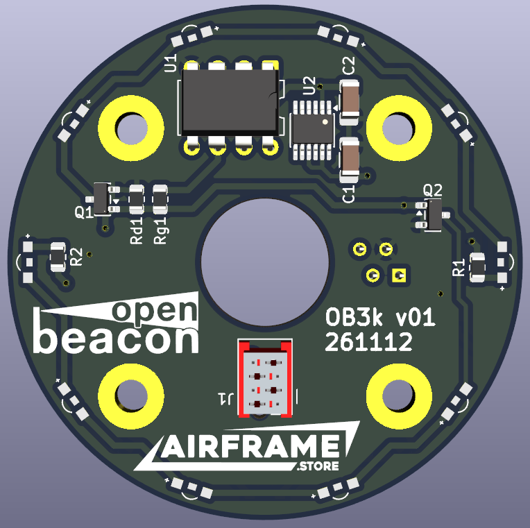

# OpenBeacon
An open source synchronized beacon light for experimental aircraft by [Airframe.Store](https://www.airframe.store).

# Motivation
The goal is to develop an open source beacon light pcb that can be used wherever no "Form 1" is needed to exchange costly COTS components with self-made hardware.

# Modularity
Some OpenBeacon Devices like the OB3k are modular, so that users can choose either a light and low profile beacon or a stacked version of two or more OB3k PCBs if more visibility is desired. The entire system of blinking lights is also modular, lights can be added or removed and the rest will keep blinking in sync. This also applies to devices removed (or destroyed?) during runtime.

# Synchronized
OpenBeacon uses an open-collector Sync-Bus were all participants are equals. Everytime a bus participant finishes its blink pattern it pulls the sync bus low to send a sync pulse to all bus members. With all devices counting a tiiiiny bit differently, the fastest member to reach the end of its blink frame sends the pulse. If the fastest member is removed from the bus, the second fastest takes its job.

## OpenBeacon Frame
The OpenBeacon blinking patterns are programmed so that they all fit within one (or a whole-numbered fraction of one) OpenBeacon Frame that is 3000 ms long. When powered up, each device will start blinking in its uniquely programmed pattern that repeats every 3000 ms. When a sync pulse appears on the sync bus, the pattern restarts.

### Standard Patterns
Standard Patterns include:  
Beacon: 1000ms on, 2000ms off  
ACL: 50ms on, 100ms off, 50ms on, 1300ms off (x2)  
WigWag: 1500ms on, 1500ms off (or vice versa for the wigwag partner light)  

### Custom Patterns
programming TBD

## Open-Collector Sync-Line
After the Frame is completed, the device will pull the sync bus low for 2 ms causing all devices that are listening on the bus to restart their frame. Since the bus is an open-collector bus, all devices can equally pull the bus low, without damaging one another. Also, since all bus participants evaluate if the bus is already low before pulling low, simultaneous low-pulling is unlikely.

# Devices
## Beacon OB3k
  
The OpenBeacon 3k is a cylindrical stackable low profile Beacon light. The PCB has 20 powerful red [Side View LEDs by Würth Elektronik](https://www.we-online.com/de/components/products/led/leds/color_led/chip_led_side_view),  10 on the top layer spaced 36° appart and 10 on the bottom layer spaced 18° from the top LEDs. 
## Programmable Blink Cycles
The following are recommendations but with OpenBeacon, individual blink patterns can be programmed into each device.
### Anti Collision Lights (ACL)
ACLs, often white at the wing tips, rear, top and/or bottom give short flashes. They usually blink in a "blink-blink pause" sequence that repeats every 1.5 seconds. This pattern fits twice in a standard OpenBeacon frame.
### Beacons
Beacons, most often red lights on the top or bottom of the fuselage, usually have a longer on-time than ACLs. They can blink in sync or shifted by half a phase from the ACLs. They usually have a 25-50% on-time over a OpenBeacon half-frame.
### WigWag Blinking Lights
WigWag Lights are often used in forward pointing lights to increase heads-on visibility with a bright white light. The WigWag pattern (lights jumping left to right) further increase visibility. Two WigWag lights usually turn on back and forth each at 50% of a full OpenBeacon Frame, so that the Light jumps to the other side every 1.5 seconds.
